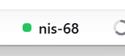
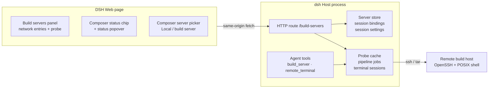

# DSH Build Servers

English | [中文](README.zh.md)

A DeepSeek Harness bundle for working with remote build machines from inside a conversation: bind one server to the current session, upload local source, run **configure → build → install → test**, watch the result, and open an SSH shell without leaving the chat.



> Status: v1.0.0. The bundle is tested against a Red Hat Enterprise Linux 8 build host from Windows. It is not a CI system; it is a small, inspectable bridge to one machine at a time.

## Features

- **Network-only server panel** — name, SSH target/alias, port, enable/disable, live OS/IP probe. No paths or commands are stored on the server entry.
- **Per-session binding** — each conversation binds one server. New sessions start as **Local**; pick a server from the composer picker next to the permission control. A workspace still records the last server used, but no longer inherits it automatically.
- **Session compile settings** — local source directory, sync path (where the source is copied), build path (where the stage commands run, defaulting to `<sync path>/build`), upload excludes, and the `configure` / `build` / `install` / `test` commands are stored per session. Empty stage commands fall back to `cmake ..`, `cmake --build . -j$(nproc)`, `cmake --install .`, and `ctest`.
- **Upload → configure → build → install → test** — local `tar` piped into `ssh … tar -x`, followed by the configured stages through `bash -lc`; stops at the first failure and can be stopped mid-stage. Live stage status, exit codes, durations, and output.
- **SSH terminal** — a persistent `ssh -tt … bash -l` per server, shared by the UI, the terminal tabs, and the agent tools. Line mode (no full-screen TUI). The right sidebar guide also has a **New remote terminal** card that opens this session's build-server shell in a tab.
- **Conversation status chip** — appears only when a server is bound: the original green status light plus the current state (Ready, Upload, Configure, Build, Install, Test, Reconnecting, Disconnected); clicking opens an in-place status popover with load, memory, disk, uptime, and a state strip. Local sessions show no chip.
- **Agent tools** — `build_server` (`status` / `run` / `pipeline` / `stop`) and `remote_terminal` (`list` / `open` / `send` / `read` / `close`), so the model can drive the same server and shell as the UI.

## Architecture



The browser never talks to SSH directly: every operation goes through a same-origin Host route, and the Host owns the server list, probes, pipelines, and terminals.

## Requirements

- A DeepSeek Harness installation with the Web UI and `plugin_manager` (this bundle targets the 0.2.x bundle API).
- A local OpenSSH client with key-based, non-interactive authentication to the build host (`BatchMode=yes`). Passwords and keys are never stored by this plugin.
- `tar` on the local machine and on the build host.
- A POSIX shell on the build host (`/proc`, `hostname`, `sed`, `awk`, `find`, `df`, `git` are used opportunistically).

## Install

From npm (recommended for v1.0.0 and later):

```text
plugin_manager install_bundle
  target: dsh-build-servers@1.0.0
```

From a checkout of this repository:

```text
plugin_manager install_bundle
  target: D:\path\to\dsh-build-servers
```

Or, after pushing a commit:

```text
plugin_manager install_bundle
  target: git+https://github.com/ji-tz/dsh-build-servers.git#<commit>
```

If the package lives in a subdirectory of a larger repository, append `&path:/build-servers` to the Git spec.

The plugin is enabled immediately. If the sidebar or composer does not show the new entries, reload the page once (`Ctrl+R`); the client half is served as a bundle.

### From a plugin market index

This repository ships a format-1 market index at [`market/index.json`](market/index.json). Add its raw URL in Settings → Plugins → Discover (the experimental plugin-market bundle must be enabled):

```text
https://raw.githubusercontent.com/ji-tz/dsh-build-servers/main/market/index.json
```

The index points at the npm registry version.

## Use

1. Open the left sidebar's **Build servers** panel and add a server: display name, SSH target (alias / `user@host` / IP), optional port.
2. In a new session, use the compact picker next to the permission chip in the composer toolbar to choose a build server (**Local** by default). Open **Compile settings** from the status popover: local source path (defaults to the current workspace), sync path, build path (defaults to `<sync path>/build`), upload excludes, and the stage commands.
3. With a server bound, a status chip appears below the composer showing the status light plus **Ready / Upload / Configure / Build / Install / Test / Reconnecting / Disconnected**. Local sessions have no chip. Click it for load/memory/disk and the state strip; its **Compile settings** button opens this session's project settings.
4. **Compile settings** is also one click away on the right of the bound server row in the composer picker menu. Build-server network entries live only in the left **Build servers** panel. Agent tools use the same binding.

## Storage

The plugin keeps its state under `~/.dsh` (or `%USERPROFILE%\.dsh` on Windows):

| File | Contents |
|---|---|
| `build-servers.json` | Network entries only: id, name, target, port, enabled |
| `build-server-bindings.json` | Per-session bindings and per-workspace last-used server |
| `build-server-settings.json` | Per-session paths, excludes, and stage commands |

Nothing is written to the remote machine except the uploaded source and whatever the configured commands do.

## Security

- All SSH traffic uses your local OpenSSH configuration and agent; the plugin never sees passwords.
- The Host route is bound to the same local Web server as the UI, requires a same-origin marker header for mutations, and is not reachable from other origins.
- `configure` / `build` / `install` / `test` and the terminal run **arbitrary commands** with your SSH identity. Only add machines you trust, and keep the stage commands and shell contents under review.
- The `remote_terminal` and `build_server` tools execute without an extra approval prompt. If you need approval, add a `ctx.tools.guard()` or gate the tools in the preset.

## Limitations

- The terminal is line-oriented; full-screen applications (`vim`, `top`) are not supported.
- The status popover and the build dialog use frame-level overlays; they are positioned from the chip's bounding box and close on outside click / `Escape`.
- The bundle is published as [`dsh-build-servers`](https://www.npmjs.com/package/dsh-build-servers) on npm; `1.0.0` is the first stable release. The GitHub repository remains the source of truth.
- Host helper tests run with Node; the UI has no automated tests.

## Development

The bundle is plain JavaScript; there is no build step.

| File | Role |
|---|---|
| `index.js` | Host half: HTTP prefix route `/build-servers`, SSH probes, upload, pipeline, terminals, agent tools |
| `client.js` | Browser half: sidebar panel, status chip, dialogs, menus, terminal UI |
| `cordis.patch.yml` | Loader row inserted into the profile |
| `DESIGN.md` | Architecture and design notes |
| `market/index.json` | Format-1 plugin market index for the Discover tab |
| `test/host.test.js` | Node tests for the pure Host helpers |
| `docs/status-chip.png` | Status chip screenshot used above |
| `locale/*.json` | Plugin Manager metadata (title/description) |
| `icon.svg` | Bundle icon |

Run the tests with:

```text
npm test
```

After editing, reload the plugin from Plugin Manager (toggle it off/on) and refresh the page. The Host reads `index.js` at activation; the browser reads the served Client bundle on page load.

## License

MIT — see [LICENSE](LICENSE).
