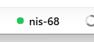
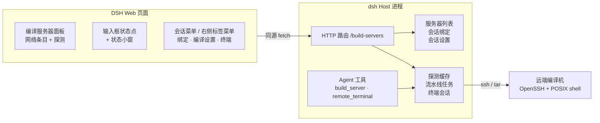

# DSH 编译服务器

[English](README.md) | 中文

一个 DeepSeek Harness 插件（bundle）：在对话里直接使用远端编译机。为当前会话绑定一台服务器，上传本地源码，执行 **构建 → 安装 → 测试**，查看结果，并打开 SSH 终端。



> 状态：v0.1.0，早期但可用。已在 Windows 客户端 + Red Hat Enterprise Linux 8 编译机上验证。它不是 CI 系统，只是一座小而可检查的桥：一次连一台机器。

## 功能

- **只配网络参数的服务器面板**：名称、SSH 目标/别名、端口、启用/停用、在线探测（系统、IP）。服务器条目里不存路径和命令。
- **按会话绑定**：每个对话绑定一台服务器；工作区记住最近一次使用的服务器，新会话默认继承；显式解绑也会被记住。
- **会话级编译设置**：本地源码目录、远端构建路径、上传排除、`build` / `install` / `test` 命令都按会话保存。
- **上传 → 构建 → 安装 → 测试**：本地 `tar` 管道送入 `ssh … tar -x`，随后各阶段通过 `bash -lc` 执行；首个失败即停，可中途停止；实时显示阶段状态、退出码、耗时和输出。
- **SSH 终端**：每台服务器一个常驻 `ssh -tt … bash -l`，UI、会话弹窗、Agent 工具共用同一个会话。行模式，不支持全屏 TUI。
- **对话状态栏**：输入框下方一个绿/黄/红状态点 + 服务器名；点击原地弹出小窗，显示负载、内存、磁盘、运行时长和当前流水线阶段。
- **Agent 工具**：`build_server`（`status` / `run` / `pipeline` / `stop`）和 `remote_terminal`（`list` / `open` / `send` / `read` / `close`），模型和用户操作同一台服务器、同一条 shell。

## 架构



浏览器不直接连 SSH：所有操作都走同源 Host 路由，服务器列表、探测、流水线和终端都由 Host 持有。

## 环境要求

- 带 Web UI 和 `plugin_manager` 的 DeepSeek Harness（目标为 0.2.x bundle API）。
- 本机 OpenSSH 客户端，并已配置免密登录（`BatchMode=yes`）。插件不保存密码或密钥。
- 本机和编译机都有 `tar`。
- 编译机有 POSIX shell（会按需使用 `/proc`、`hostname`、`sed`、`awk`、`find`、`df`、`git`）。

## 安装

从本仓库 checkout 安装：

```text
plugin_manager install_bundle
  target: D:\path\to\dsh-build-servers
```

或从 Git commit 安装：

```text
plugin_manager install_bundle
  target: git+https://github.com/ji-tz/dsh-build-servers.git#<commit>
```

如果包在仓库子目录，追加 `&path:/build-servers`。

安装后插件立即启用。侧边栏或输入框下方没有出现新入口时，刷新一次页面（Ctrl+R）。

### 从插件市场安装

仓库自带 format 1 的市场索引 [`market/index.json`](market/index.json)。在 Settings → Plugins → Discover 里添加：

```text
https://raw.githubusercontent.com/ji-tz/dsh-build-servers/main/market/index.json
```

需要先启用实验性的 plugin-market bundle。索引目前指向 commit 固定的 Git 源；首次 npm 发布后可改为 registry 版本。

## 使用

1. 左侧「编译服务器」面板添加服务器：显示名、SSH 目标（别名 / `user@host` / IP）、可选端口。
2. 在对话里点会话行的 `...` → **编译服务器…**，选择服务器，填写 **编译设置**：本地源码路径、远端构建路径、上传排除、各阶段命令。
3. 输入框下方出现状态点 + 服务器名。点击查看负载/内存/磁盘和阶段状态；在弹窗里启动流水线，日志也在同一弹窗。
4. 会话菜单、右侧标签菜单（**编译服务器终端**）和状态栏都指向同一台服务器；Agent 工具使用同一绑定。

## 存储

状态保存在 `~/.dsh`（Windows 为 `%USERPROFILE%\.dsh`）：

| 文件 | 内容 |
|---|---|
| `build-servers.json` | 仅网络条目：id、name、target、port、enabled |
| `build-server-bindings.json` | 按会话的绑定，以及按工作区的最近使用服务器 |
| `build-server-settings.json` | 按会话的路径、排除和阶段命令 |

除上传的源码和配置命令本身外，不会向远端写入其他内容。

## 安全

- SSH 全部使用本机 OpenSSH 配置和 agent；插件看不到密码。
- Host 路由与 UI 共用本地 Web 服务，变更请求要求同源标记头，不接受其他源。
- `build` / `install` / `test` 和终端会以你的 SSH 身份执行**任意命令**。只添加可信机器，并审查阶段命令和 shell 内容。
- `remote_terminal` 和 `build_server` 工具不会额外弹审批。需要审批时，在 preset 里加 `ctx.tools.guard()` 或限制工具。

## 限制

- 终端是行模式，不支持 `vim`、`top` 这类全屏程序。
- 状态小窗和详情弹窗使用框架级浮层，按状态点坐标定位，点击外部或 Esc 关闭。
- 目前尚未以正式 npm scope 发布，包名仍是 `@local/build-servers`；GitHub 仓库是当前的事实来源。
- Host 纯函数有 Node 测试；UI 还没有自动化测试。

## 开发

纯 JavaScript，无构建步骤。

| 文件 | 作用 |
|---|---|
| `index.js` | Host 半：`/build-servers` 路由、SSH 探测、上传、流水线、终端、Agent 工具 |
| `client.js` | 浏览器半：侧边栏面板、状态点、弹窗、菜单、终端 UI |
| `cordis.patch.yml` | 插入 profile 的 Loader 行 |
| `DESIGN.md` | 架构与设计说明 |
| `market/index.json` | format 1 插件市场索引 |
| `test/host.test.js` | Host 纯函数 Node 测试 |
| `docs/status-chip.png` | README 用的状态栏截图 |
| `locale/*.json` | Plugin Manager 元数据 |
| `icon.svg` | 插件图标 |

运行测试：

```text
npm test
```

修改后，在 Plugin Manager 里关闭再启用插件，并刷新页面。Host 在激活时读取 `index.js`，浏览器在页面加载时读取 Client bundle。

## 许可证

MIT，见 [LICENSE](LICENSE)。
